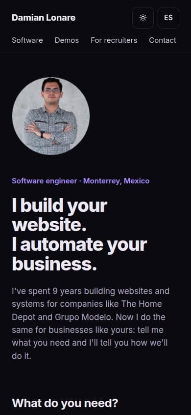
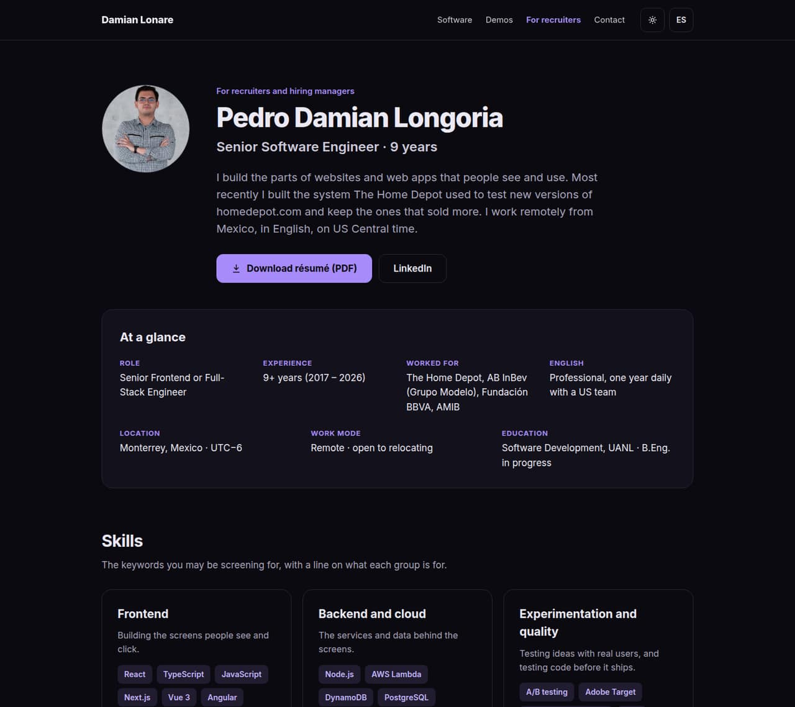
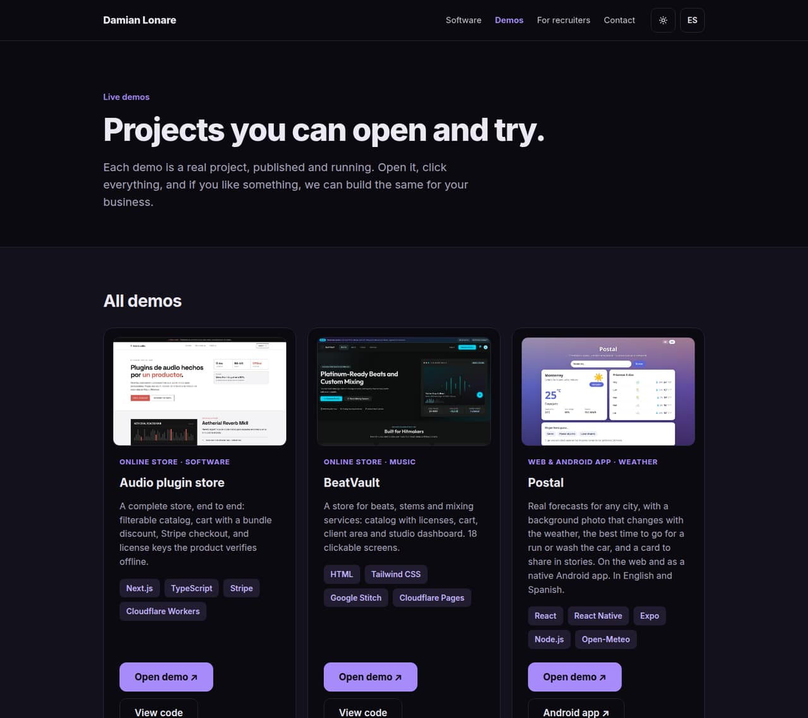

# Damian Lonare

Personal site of **Pedro Damian Longoria** (Damian Lonare), a senior software engineer in Monterrey, Mexico, with 9 years of experience. Most recently he built the A/B testing system The Home Depot used on homedepot.com. The public brand on the site is Damian Lonare. The page for recruiters uses Pedro Damian Longoria.

The site is bilingual. Spanish is the default. English lives under `/en`, including a profile written for recruiters and hiring managers.

**Live:** [damianlonare.com](https://damianlonare.com)

## Features

- Home, software services, live demos, and a recruiter profile, each with its own Spanish and English metadata
- Link-in-bio at [`/links`](https://damianlonare.com/links/) with a featured Lonare lyric video
- Light and dark themes, following the system preference until the visitor chooses
- Résumé PDFs in Spanish and English
- Contact through WhatsApp, LinkedIn, and GitHub

## Tech stack

- [Next.js 15](https://nextjs.org/) App Router, exported as a static site (`output: "export"`)
- React 19 and TypeScript
- One stylesheet, `app/globals.css`
- Hosted on [Cloudflare Pages](https://pages.cloudflare.com/)

## Architecture

All copy lives in `content/`. The pages only arrange it.

```
app/(es)/            Spanish routes: /, /software, /demos, /contratar, /links
app/(en)/en/         English routes: /en, /en/software, /en/demos, /en/hire
components/          Header, footer, theme toggle, and shared page sections
content/content.ts   Bilingual copy, routes, and outbound links
content/link-page.ts Buttons on /links
public/              Photo, demo images, and CV PDFs
scripts/             YouTube refresh used by the build and by GitHub Actions
```

An empty string in `content/content.ts` hides that button. `links.email` is still empty, so the email button stays off the page.

## Run locally

Node.js 22.

```bash
npm install
npm run dev      # http://localhost:3000
npm run build    # writes the static site to /out
npm start        # serves /out
```

## Build and deploy

Cloudflare Pages builds this repository and publishes the `out` directory produced by the static export.

| Setting | Value |
| --- | --- |
| Build command | `npm run build` |
| Output directory | `out` |
| Node.js | 22 |

Each production build refreshes the featured video on `/links` from YouTube before the pages are generated. If YouTube does not respond, the last good snapshot in `content/music-video.json` stays in place. [`.github/workflows/refresh-music-video.yml`](.github/workflows/refresh-music-video.yml) commits a new snapshot every six hours when the pick changes, which is what gets that section rebuilt.

## Screenshots

English pages, dark theme.

**Home, desktop**


**Home, phone**



**For recruiters** ([/en/hire](https://damianlonare.com/en/hire/))



**Live demos** ([/en/demos](https://damianlonare.com/en/demos/))



## En español

Sitio personal de Pedro Damian Longoria (Damian Lonare), ingeniero de software senior en Monterrey, con 9 años de experiencia. Next.js y TypeScript, exportado como sitio estático y publicado en Cloudflare Pages: [damianlonare.com](https://damianlonare.com). El español está en `/` y el inglés en `/en`. Para correrlo en local: `npm install` y `npm run dev`. `npm run build` deja el sitio listo en `out/`.
